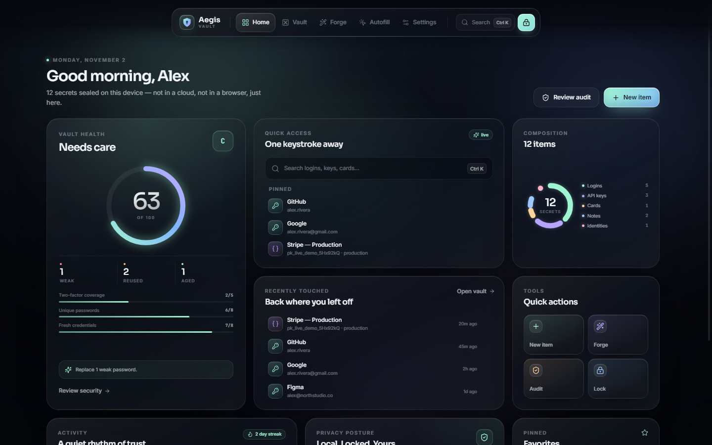

# Aegis — a liquid-glass desktop vault

A local-first, encrypted desktop vault for passwords, API keys, cards, secure notes and identities. Built with Electron, React and TypeScript. Everything lives in one AES-256-GCM encrypted file on your machine — no account, no cloud, no telemetry.



The marketing site for it lives in [`website/`](website) — a separate Vite app with a cinematic cold-start vault door, a real WebGL hero, a 3D anatomy of the encrypted file, a scroll-driven product tour and the installer download.

## Highlights

- **Liquid-glass interface** — layered aurora lighting, frosted glass surfaces, claymorphic controls, floating bento navigation, spring page transitions and reduced-motion support.
- **Encrypted at rest** — scrypt (N=32768, r=8, p=1) key derivation with AES-256-GCM authenticated encryption. Plaintext never touches disk.
- **Auto-lock** — locks after idle minutes, on window blur (optional), on system lock/suspend, and via `Ctrl+L`.
- **Secure clipboard** — sensitive values clear automatically after a configurable delay; a global wipe runs on quit.
- **Live 2FA codes** — paste an `otpauth://` URI or Base32 secret and Aegis renders a rolling TOTP code with a countdown ring.
- **Password Forge** — passphrase / random generator with length, character-set, ambiguity and strength feedback.
- **Security audit** — strength, reuse, age, missing 2FA and optional Have I Been Pwned range checks (only a 5-character SHA-1 prefix leaves the machine).
- **Autofill** — a focused browser pane with a credential picker, one-click fill/copy and an allow-listed HTTPS webview.
- **Encrypted backups** — export/import `.aegis` files protected by their own password.
- **Command palette** — `Ctrl+K` for fuzzy search, navigation and quick actions.
- **Variable window** — frameless custom titlebar with native window controls; minimum 1040×740.

## Run it

```bash
npm install
npm run dev        # Vite + Electron with hot reload
```

Build the renderer and launch the packaged-style app:

```bash
npm run build
npm start
```

Create a Windows installer:

```bash
npm run dist       # NSIS installer in release/
```

Build the macOS app (works from Windows or Linux — see below):

```bash
npm run dist:mac   # Aegis-<version>-mac-arm64.zip + -mac-x64.zip, copied into website/public/downloads
```

## Keyboard shortcuts

| Shortcut | Action |
| --- | --- |
| `Ctrl+K` | Command palette |
| `Ctrl+N` | New item |
| `Ctrl+G` | Password generator |
| `Ctrl+L` | Lock vault |
| `Ctrl+Shift+Space` | Global quick search (system-wide) |
| `Ctrl+Shift+L` | Global lock (system-wide) |
| `Esc` | Close modal / palette |

## Updates

Aegis updates itself from GitHub Releases. Installed builds check about seven seconds after launch and every six hours after that, on resume from sleep, and whenever you press **Check for updates** in Settings → About. When a newer release exists, an in-app card shows the version and release notes with download progress, then offers **Restart & install**. Updates replace the application only; the encrypted vault file is untouched.

Every push to `main` runs [`.github/workflows/release.yml`](.github/workflows/release.yml), which stamps a version from the Actions run number (`1.0.<run>`), builds the Windows NSIS installer and a universal macOS app, uploads them to a draft release, verifies `latest.yml` / `latest-mac.yml`, and publishes the release. Pushing code alone is not enough for an update — the workflow's build is what `electron-updater` sees. You can also run it manually from the Actions tab.

Dev builds (`npm run dev`) report the updater as disabled; only installed builds can update. Windows NSIS installs update unsigned. macOS requires a Developer ID–signed build for Squirrel.Mac to apply an update, so the unsigned preview can detect a release but not install it.

## The macOS build

`npm run dist:mac` runs [`scripts/build-mac.py`](scripts/build-mac.py), which assembles an unsigned
`Aegis.app` from the official Electron darwin binaries. It never extracts anything to disk: it rewrites the
Electron release zip entry-by-entry, so the framework symlinks, unix modes and the Mach-O signatures already
inside Electron's binaries survive, and the app plus its four helper bundles are renamed the way Chromium
expects (`Aegis Helper (GPU)`, `(Plugin)`, `(Renderer)`). The payload is the *same* `app.asar` the Windows
build ships — the script reuses it verbatim when `release/win-unpacked/resources/app.asar` exists, so every
platform runs identical code (verified byte-for-byte in CI-style checks below).

Both zips are structured tested after building: entry counts, 14 preserved symlinks, executable bits,
`Info.plist` identity, helper executable names, and a full CRC read of every entry.

**What it is not:** signed or notarised. It was assembled and inspected on Windows without a Mac to launch
it on, so treat it as an unsigned preview. macOS will ask for a right-click → **Open** on first launch; if it
reports the app as damaged, re-sign it ad-hoc on the Mac:

```bash
xattr -dr com.apple.quarantine /Applications/Aegis.app
codesign --force --deep --sign - /Applications/Aegis.app
```

For a proper signed, notarised, DMG-shipping build, run `npm run dist:mac:signed` **on macOS** with a
Developer ID certificate — the `mac` section of `package.json` is already configured (dmg + zip,
`public.app-category.productivity`, `build/icon.icns`).

The macOS menu bar is wired too: the app installs the standard app/edit/view/window roles on darwin and
stays menu-less on Windows and Linux, where the window chrome is custom.

## Where your data lives

`%APPDATA%/Aegis/aegis.vault` on Windows (`app.getPath('userData')` elsewhere). The file is a JSON envelope containing the KDF parameters, IV, auth tag and ciphertext — no item names, URLs or secrets. A `.bak` copy is kept beside it on each write.

Losing the master password means losing the vault. The hint is stored in clear text in the envelope by design; use it as a memory aid, not as a second password.

## Security model

- Master password → 32-byte key via scrypt with a random 16-byte salt.
- AES-256-GCM with a fresh 12-byte IV per save; authentication rejects tampered files.
- Vault key and decrypted data only exist in the Electron main process while unlocked.
- Renderer runs with `contextIsolation`, no Node integration and a narrow preload IPC bridge.
- External links open in the system browser; navigation inside the autofill webview is restricted to HTTPS.
- Breach checks use k-anonymity (`api.pwnedpasswords.com/range/<prefix>`); full hashes and passwords never leave the device.

This is a personal, offline vault — not an audited password manager. For high-value accounts, pair it with hardware-backed 2FA.

## Project structure

```
electron/        main process, encryption, IPC, preload bridge
src/
  components/    glass shell, nav, dialogs, editor, detail, TOTP
  pages/         Gate (onboarding/unlock), Dashboard, Vault, Forge,
                 Autofill, Settings
  lib/           strength, generator, TOTP, health, field schemas, mock bridge
  styles/        design system + page layouts
scripts/         visual QA, end-to-end checks, icon and macOS packaging
website/         marketing site (own Vite project, see below)
```

## Landing site (`website/`)

A separate single-page marketing site for the app: a cinematic cold-start sequence (machined 3D door,
retracting bolts, key-derivation HUD, then the door swings open onto the page), a real WebGL vault-door hero,
a scroll-pinned 3D exploded view of the vault file, a cinematic screen tour, masked headline reveals, an
interactive live password forge, a four-palette theme switcher and the download flow with checksum.

The intro is skippable with `Esc` and is bypassed entirely for `prefers-reduced-motion` or by opening
`/?intro=off`.

```bash
cd website
npm install
npm run dev        # http://localhost:5310
npm run build      # static build into website/dist
npm run preview    # serve the built output on :5311
```

Everything editable about the site's claims and links lives in [`website/src/config.ts`](website/src/config.ts) —
version, platform list, FAQ copy, repository links, and the installer's size and SHA-256.

The site is live at **https://aegis-desktop.vercel.app**. The download buttons call the site's own backend
(`/api/download?asset=windows|mac-zip|mac-dmg`), which resolves the latest GitHub release on the server and
redirects to the matching installer. The binaries stay on GitHub Releases because Vercel functions have a
response-size limit; the backend gives the site stable same-origin URLs without duplicating 300 MB of
installers. The version, sizes and SHA-256 values in `website/src/config.ts` are the fallback when the API is
unavailable; the page refreshes them from `/api/release` when the backend responds.

### Deploy the site

The Vercel project uses `website/` as its root, builds with `npm run build`, and publishes `dist`. Its two
serverless functions live in `website/api`: `GET /api/release` returns the latest release metadata and
`GET /api/download?asset=...` redirects whitelisted installer requests. Deploy from the site directory:

```bash
cd website
vercel link        # first time on a new machine; choose aegis-desktop
vercel deploy --prod
```

Set an optional `GITHUB_TOKEN` environment variable in the Vercel project to raise the GitHub API rate limit;
public releases work without it. `website/.vercelignore` keeps the local `public/downloads/` archive and local
env files out of deployments. Run `vercel git connect` from `website/` if you want Vercel to deploy on Git
pushes instead of using the CLI.

`npm run dev` serves the Vite UI only and links directly to GitHub; run `vercel dev` from `website/` when you
want to exercise the API routes locally.

Site visuals can be re-captured for review with:

```bash
npx electron website/scripts/finalqa.cjs          # cold start, hero, anatomy, download, mobile
npx electron website/scripts/reduced.cjs          # reduced-motion pass
```

## Checks

```bash
npx tsc --noEmit                      # typecheck
npm run build                         # production renderer
npx electron scripts/e2e.cjs          # full Electron flow (needs dev server)
E2E_PROD=1 npx electron scripts/e2e.cjs
```

The end-to-end script creates a vault in a temp profile, saves an item through the UI, asserts the file contains no plaintext, locks, unlocks and loads the secure browser.
